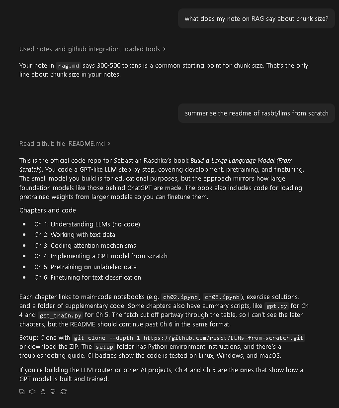
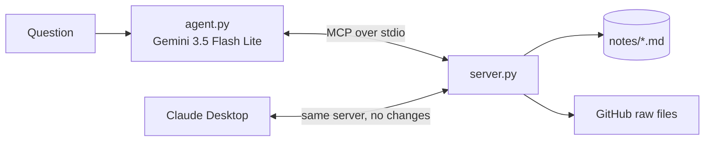
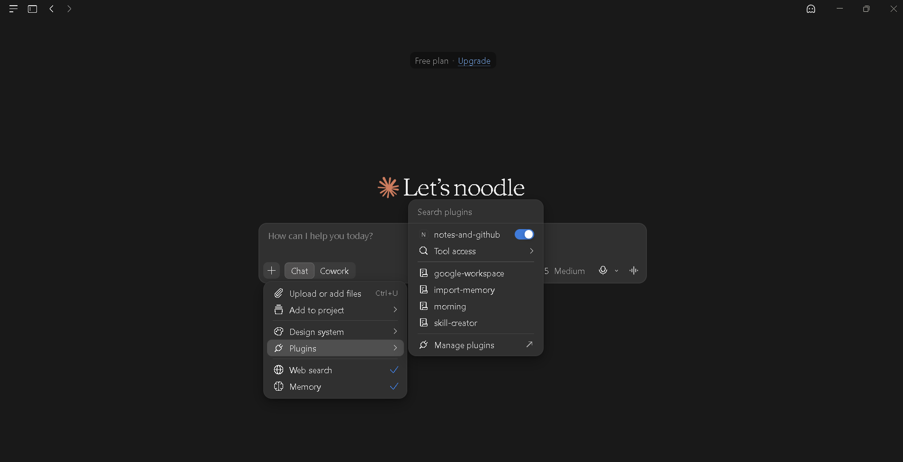
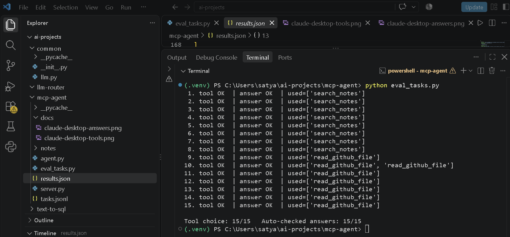

# MCP-powered agent

An MCP server that exposes notes search and GitHub file reading as tools, and an agent that calls them. The same server also runs unchanged in Claude Desktop.



## How it fits together



Tools: `search_notes` (keyword search over local markdown notes) and `read_github_file` (reads a file from a public repo).

## Run it

```
pip install -r requirements.txt
# create a .env file in the repo root containing: GEMINI_API_KEY=your_key
python mcp-agent/agent.py "What does my note on RAG say about chunk size?"
```

To use the server in Claude Desktop, add it under `mcpServers` in `claude_desktop_config.json` (command = path to your Python, args = path to `server.py`).



## Results

| Metric | Score |
|---|---|
| Correct tool chosen first | 15/15 |
| Final answer correct (checked by hand) | 15/15 |

15 tasks in `tasks.jsonl` (8 notes, 7 GitHub). Tool choice is scored automatically from the agent's tool calls. Answers go through a keyword check first, and I then read all 15 myself and compared the two longest against the live READMEs. Full output is in `results.json`.

Limitation: every task names its source ("my notes", "README of X"), so this tests tool calling and argument filling, not tool discovery.



## What failed and what I changed

- MCP Inspector wouldn't connect: it stripped the backslashes from my Windows path, so I gave it the filename instead of a full path.
- Claude Desktop ignored my config: the Microsoft Store version keeps its real config in a different folder from the documented one, so I located it by searching the app's data folders.
- The big model's free quota is only 20 requests a day, so the agent uses the small model.
- READMEs are cut off at 6000 characters by the tool, so long files come back truncated.

## Next

- Raise the truncation limit or let the tool page through long files.
- Harder tasks: ambiguous questions, questions that need both tools, questions that need no tool.
- Add a tool that writes a new note.